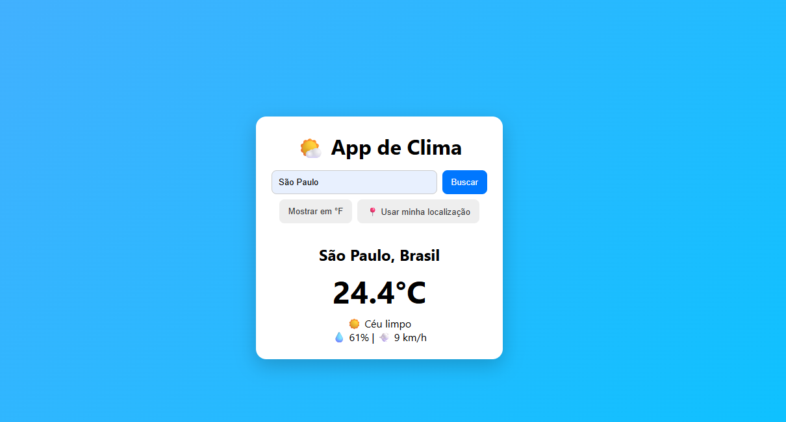

# 🌤️ App de Clima

Aplicação web que permite consultar as condições climáticas de cidades ao redor do mundo. Desenvolvida utilizando HTML, CSS e JavaScript puro, com integração à API Open-Meteo.

🔗 **Demonstração:** [Acessar o App de Clima](https://kaxinhoskx.github.io/app-de-clima-pog/)



## ✨ Funcionalidades

- 🔎 Busca de clima pelo nome da cidade.
- 🌡️ Exibição da temperatura atual.
- 💧 Informações sobre umidade.
- 💨 Velocidade do vento.
- 🔄 Alternância entre Celsius (°C) e Fahrenheit (°F).
- 📍 Consulta do clima pela localização do usuário.
- ⚠️ Tratamento de erros, como cidades inexistentes e falhas de conexão.
- 📱 Layout responsivo para computadores e celulares.

## 🛠️ Tecnologias utilizadas

- **HTML5:** estruturação semântica.
- **CSS3:** estilização, Flexbox, Grid e gradientes.
- **JavaScript ES6+:** manipulação do DOM, eventos, Fetch API e Async/Await.
- **Open-Meteo API:** fornecimento de dados meteorológicos gratuitos.

## 🚀 Como executar o projeto

1. Clone este repositório:

```bash
git clone https://github.com/kaxinhoskx/app-de-clima-pog.git
```

2. Entre na pasta:

```bash
cd app-de-clima-pog
```

3. Abra o arquivo `index.html` no navegador ou utilize a extensão Live Server do VS Code.

## 📚 Conhecimentos desenvolvidos

Durante este projeto, pratiquei:

- Consumo de APIs REST utilizando `fetch`.
- Requisições assíncronas com `async/await`.
- Encadeamento de requisições de geolocalização e previsão do tempo.
- Manipulação do DOM e tratamento de eventos.
- Utilização da Geolocation API do navegador.
- Tratamento de erros com `try/catch`.
- Publicação de projetos utilizando GitHub Pages.

## 👤 Autor

**Kayo**

- [GitHub](https://github.com/kaxinhoskx)
